# Hi, I'm Emilio 👋

> *É o vibe e o codas.*

Back-end developer and CLI tools builder. Passionate about lightweight software solving real problems: TypeScript & Rust CLIs, AI metering/proxies, and low-level Linux integrations.

  <a href="https://ens-emilio.github.io/">🌐 <b>Portfolio Website</b></a> •
  <a href="README.pt-BR.md">🇧🇷 <b>Ler em português</b></a>

<!-- Tech Stack Badges (GPRM style) -->

  
  
  
  
  
  
  

---

### ⚡ About Me

- 🔭 **Currently building:** [odotoken](https://github.com/ens-Emilio/odotoken) (AI token metering and budget guardrails) & [KaadoNeuro](https://github.com/ens-Emilio/KaadoNeuro) (local-first flashcards PWA with spaced repetition).
- 🌱 **Exploring & Learning:** Rust, native Linux architecture, Wayland protocols, and terminal coding agent harnesses ([NoushiCLI](https://github.com/ens-Emilio/NoushiCLI)).
- 💬 **Ask me about:** TypeScript, backend architectures, Python, reverse engineering workflows, and Git automation.
- ⚡ **Fun fact:** I love reverse-engineering apps just to understand how their internal machinery works.

---

### 🚀 Featured Projects

| Project | Description | Stack / Focus |
| :--- | :--- | :--- |
| **[NoushiCLI](https://github.com/ens-Emilio/NoushiCLI)** | Terminal coding agent harness & autonomous workflow tool | TypeScript / CLI |
| **[odotoken](https://github.com/ens-Emilio/odotoken)** | AI token metering proxy with strict budget guardrails | API / Proxy / AI |
| **[KaadoNeuro](https://github.com/ens-Emilio/KaadoNeuro)** | Offline flashcards PWA with Anki `.apkg` import | PWA / Local-First |
| **[pretium](https://github.com/ens-Emilio/pretium)** | Open API for comparing AI model execution costs in real-time | Backend / API |
| **[wintest](https://github.com/ens-Emilio/wintest)** | Unified Windows UI testing platform | Desktop / Testing |

---

### 📊 GitHub Activity & Metrics

  
  

  

 

📈 <b>Detailed Contribution & Rhythm Cards</b>

 

<picture>
  <source media="(prefers-color-scheme: dark)" srcset="https://raw.githubusercontent.com/ens-Emilio/ens-Emilio/cards/summary-dark.svg">
  
</picture>
<picture>
  <source media="(prefers-color-scheme: dark)" srcset="https://raw.githubusercontent.com/ens-Emilio/ens-Emilio/cards/languages-dark.svg">
  
</picture>

<picture>
  <source media="(prefers-color-scheme: dark)" srcset="https://raw.githubusercontent.com/ens-Emilio/ens-Emilio/cards/contributions-dark.svg">
  
</picture>
<picture>
  <source media="(prefers-color-scheme: dark)" srcset="https://raw.githubusercontent.com/ens-Emilio/ens-Emilio/cards/weekly-dark.svg">
  
</picture>

---

### 📬 Connect with Me

- 💬 Open an issue or discussion on any of the repositories above.
- 🌐 Visit the [Portfolio](https://github.com/ens-Emilio.github.io) for more projects and contact info.
