<picture>
  <source media="(prefers-color-scheme: dark)" srcset="https://raw.githubusercontent.com/ens-Emilio/ens-Emilio/cards/summary-dark.svg">
  
</picture>
<picture>
  <source media="(prefers-color-scheme: dark)" srcset="https://raw.githubusercontent.com/ens-Emilio/ens-Emilio/cards/languages-dark.svg">
  
</picture>

<picture>
  <source media="(prefers-color-scheme: dark)" srcset="https://raw.githubusercontent.com/ens-Emilio/ens-Emilio/cards/contributions-dark.svg">
  
</picture>
<picture>
  <source media="(prefers-color-scheme: dark)" srcset="https://raw.githubusercontent.com/ens-Emilio/ens-Emilio/cards/weekly-dark.svg">
  
</picture>

# Hi, I'm Emilio 👋

> É o vibe e o codas.

Back-end developer and CLI tools builder. I like small projects that solve a real problem: TypeScript and Rust CLIs, an API for comparing AI model prices, and everyday utilities.

<a href="README.pt-BR.md">🇧🇷 Ler em português</a>

- 🔭 Currently building: [odotoken](https://github.com/ens-Emilio/odotoken), AI token metering and budget guard, and [KaadoNeuro](https://github.com/ens-Emilio/KaadoNeuro), local-first flashcards with spaced repetition
- 🌱 Learning: Rust and native Linux (Tauri, Wayland integrations)
- 💬 Ask me about: TypeScript, Node.js, Python, PHP, automations and Git
- ⚡ Fun fact: I have reverse-engineered apps just to understand how they work inside

## Featured projects

| Project | What it is |
| --- | --- |
| [NoushiCLI](https://github.com/ens-Emilio/NoushiCLI) | Terminal coding agent harness |
| [KaadoNeuro](https://github.com/ens-Emilio/KaadoNeuro) | Offline flashcards PWA with Anki .apkg import |
| [odotoken](https://github.com/ens-Emilio/odotoken) | AI token metering proxy with budget guardrails |
| [pretium](https://github.com/ens-Emilio/pretium) | Open API for comparing AI model prices |
| [wintest](https://github.com/ens-Emilio/wintest) | Unified Windows UI testing platform |

## Contact

Open an issue on any of the repos above.
