# Olá, eu sou o Emilio 👋

> *É o vibe e o codas.*

Desenvolvedor back-end e criador de ferramentas de linha de comando. Focado em software leve que resolve problemas reais: CLIs em TypeScript & Rust, proxies e controle de custos de IA, e integrações nativas em Linux.

  <a href="https://ens-emilio.github.io/">🌐 <b>Site Portfólio</b></a> •
  <a href="README.md">🇺🇸 <b>Read in English</b></a>

<!-- Tech Stack Badges (estilo GPRM) -->

  
  
  
  
  
  
  

---

### ⚡ Sobre Mim

- 🔭 **Atualmente construindo:** [odotoken](https://github.com/ens-Emilio/odotoken) (medição de tokens e orçamento para uso de IA) e [KaadoNeuro](https://github.com/ens-Emilio/KaadoNeuro) (PWA offline de flashcards locais com repetição espaçada).
- 🌱 **Explorando & Aprendendo:** Rust, ecossistema Linux nativo, protocolos Wayland e agentes de código no terminal ([NoushiCLI](https://github.com/ens-Emilio/NoushiCLI)).
- 💬 **Pode perguntar sobre:** TypeScript, arquitetura backend, Python, engenharia reversa e automações Git.
- ⚡ **Curiosidade:** Já fiz engenharia reversa de diversos apps só pela curiosidade de desvendar seu funcionamento interno.

---

### 🚀 Projetos em Destaque

| Projeto | Descrição | Stack / Foco |
| :--- | :--- | :--- |
| **[NoushiCLI](https://github.com/ens-Emilio/NoushiCLI)** | Harness de agente de código para terminal e fluxos autônomos | TypeScript / CLI |
| **[odotoken](https://github.com/ens-Emilio/odotoken)** | Proxy de medição de tokens de IA com limites estritos de orçamento | API / Proxy / IA |
| **[KaadoNeuro](https://github.com/ens-Emilio/KaadoNeuro)** | Flashcards PWA offline com importação de `.apkg` do Anki | PWA / Local-First |
| **[pretium](https://github.com/ens-Emilio/pretium)** | API pública para comparação de preços de modelos de IA em tempo real | Backend / API |
| **[wintest](https://github.com/ens-Emilio/wintest)** | Plataforma unificada de testes de interface no Windows | Desktop / Testing |

---

### 📊 Atividade & Métricas do GitHub

  
  

  

 

📈 <b>Cards Detalhados de Contribuição e Ritmo</b>

 

<picture>
  <source media="(prefers-color-scheme: dark)" srcset="https://raw.githubusercontent.com/ens-Emilio/ens-Emilio/cards/summary-dark.svg">
  
</picture>
<picture>
  <source media="(prefers-color-scheme: dark)" srcset="https://raw.githubusercontent.com/ens-Emilio/ens-Emilio/cards/languages-dark.svg">
  
</picture>

<picture>
  <source media="(prefers-color-scheme: dark)" srcset="https://raw.githubusercontent.com/ens-Emilio/ens-Emilio/cards/contributions-dark.svg">
  
</picture>
<picture>
  <source media="(prefers-color-scheme: dark)" srcset="https://raw.githubusercontent.com/ens-Emilio/ens-Emilio/cards/weekly-dark.svg">
  
</picture>

---

### 📬 Contato

- 💬 Abra uma issue ou discussão em qualquer um dos repositórios acima.
- 🌐 Visite o [Portfólio](https://github.com/ens-Emilio.github.io) para mais projetos e detalhes.
